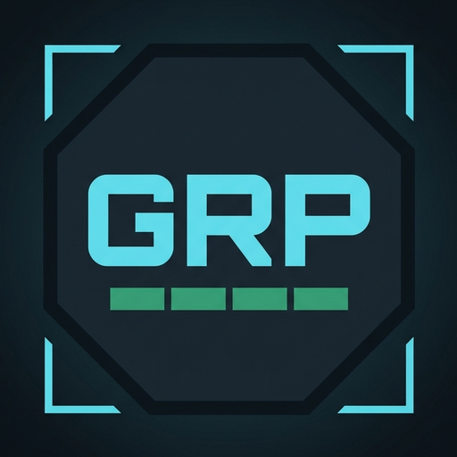

<div align="center">
  
  <h1>GRPLauncher</h1>
  <p><strong>Open-source launcher to play <em>Tom Clancy's Ghost Recon Phantoms</em> on a community-run server.</strong></p>
  <p>
    <a href="https://github.com/Aquilabot/GRPLauncher/releases/latest"></a>
    <a href="https://github.com/Aquilabot/GRPLauncher/actions/workflows/release.yml"></a>
    <a href="LICENSE"></a>
    <a href="https://ko-fi.com/aquilabot"></a>
  </p>
  <p>
    <a href="https://github.com/Aquilabot/GRPLauncher/releases/latest">Download</a> ·
    <a href="https://grp.limacashout.pro/status/">Server Status</a> ·
    <a href="LEEME.txt">Guía en español</a> ·
    <a href="https://ko-fi.com/aquilabot">Support on Ko-fi</a>
  </p>
</div>

---

## Quick start

1. Download **`GRPLauncher.zip`** from the [latest GitHub release](https://github.com/Aquilabot/GRPLauncher/releases/latest).
2. Extract the entire folder anywhere on your PC (do not run it from inside the `.zip`).
3. Open **`GRPLauncher.exe`**, pick **New account** (the launcher is in Spanish and English: **ES / EN**, top right), choose a nickname and password, and click **CREATE ACCOUNT AND PLAY**.
   - Registration is free — no invitation code required.
   - On first launch, the launcher downloads the game (~4 GB) and installs DirectX 9 if missing.
   - Future updates to both the launcher and the game happen automatically.

> **¿Hablas español?** Dentro del `.zip` encontrarás [`LEEME.txt`](LEEME.txt) con las instrucciones completas de instalación, opciones y solución de problemas.

> **Windows SmartScreen / Antivirus note:** `GRPLauncher.exe` is not code-signed yet, so Windows SmartScreen or antivirus software may warn on first run. Every release binary is compiled publicly by GitHub Actions from this repository's source code (see [Code signing policy](#code-signing-policy)), and [`LEEME.txt`](LEEME.txt) explains how to allow or exclude the launcher folder.

---

## Features

- **Community server (60 Hz, LatAm / São Paulo):** Full lobby, store, weapon customization, mystery boxes, all 8 maps across Conquest, Onslaught, and Holdout, plus adaptive bots in Quick Play (*Basic Training*) and Team Deathmatch so you can play at any hour (and PvP-only Team Capture). Check live server status at [grp.limacashout.pro/status](https://grp.limacashout.pro/status/).
- **Modern client improvements** *(optional, enabled by default)*:
  - Unlocked frame rate (automatic monitor refresh rate up to 240 FPS) and resolutions above 1920×1200.
  - Configurable field of view (**FOV 70°–110°**).
  - Unthrottled mouse movement (removes the per-frame fast-turn cap), focal-length sensitivity scaling, and separate ADS / scope multipliers.
  - Exact mouse sensitivity input with a built-in converter from **cm/360° + DPI** or other shooters (*The Finals, CS2, Apex Legends, Valorant, Overwatch 2, Call of Duty, Fortnite, Rainbow Six Siege*).
- **Vulkan rendering via DXVK** *(Windows, optional, enabled by default)*: runs the game through DXVK 3.1.1 after checking for Vulkan 1.3 support, with automatic fallback to DirectX 9 if your GPU or driver does not support it.
- **Native Linux support:** Builds natively with Tauri 2 and launches the game through `umu-run` / Proton.
- **Portable and private:** No installer, no registry entries, no telemetry or ads ([`PRIVACY.md`](PRIVACY.md)), encrypted HTTPS authentication, and automatic self-updates.

---

## Support the project

This server and launcher are **100% free and non-profit**. If you enjoy playing Ghost Recon Phantoms again and want to help keep the community server online, voluntary donations go directly toward monthly VPS hosting costs (São Paulo) and ongoing development.

[](https://ko-fi.com/aquilabot)

*¿Te gusta el proyecto? Puedes apoyar voluntariamente en [ko-fi.com/aquilabot](https://ko-fi.com/aquilabot) para ayudar a cubrir los costos mensuales del servidor (VPS) y el mantenimiento del juego.*

> Donations are strictly voluntary — no pay-to-win, paid access, or in-game advantages are sold.
> *Independent community preservation project, not affiliated with or endorsed by Ubisoft.*

---

## What it does

GRPLauncher is the program players use to play *Ghost Recon Phantoms* (a game whose official servers closed in 2016) on a community-run server: it creates or signs in to the player's account on that server, downloads the game files from it and keeps them identical for everybody, keeps itself up to date, sets the screen resolution and optional quality-of-life settings, and starts the game.

It does not modify the game's executable on disk and it is not a cheat, crack, or trainer. The game files are not part of this repository or of the program; they come from the server the player connects to.

- **Downloads:** [GitHub Releases](https://github.com/Aquilabot/GRPLauncher/releases)
- **Repositories:** primary at <https://git.limacashout.pro/aquilabot/GRPLauncher>, mirrored at <https://github.com/Aquilabot/GRPLauncher> where the automated release builds run.

---

## Technical documentation & building

Tauri 2 application: the window is plain HTML/JS in `ui/`, and the backend logic is Rust in `src-tauri/src/`. The game's own files stay as published; with "Mejoras del cliente" on, our `version.dll` next to them patches the game in memory.

### Architecture

- `core.rs`: settings, the account service (`POST /login`, `POST /register`, `POST /reset`, `POST /history`), self-update (`/launcher/version.txt`, `/launcher/GRPLauncher.exe`), the game folder check and download against the vault (`/files/<key>/manifest.txt`; the key comes back from sign-in), client improvements, resolution (`GraphicSettings.ini`), mouse sensitivity (`KeyMappingsPC.ini`), and starting the game with `/ForceDefaultSandbox=true /Sandbox=<server> /Port=<port> /OnlineAccessKey=<key>`.
- `pipe.rs`: the game's launcher protocol on `\\.\pipe\Ghost_Recon_Phantoms`. The game signs in as `<name>.<session token>`.
- `main.rs`: the Tauri commands for the window, and the headless CLI mode used in tests:
  `GRPLauncher.exe --user N --password P [--create] [--invite C] [--gamedir <folder>] [--nosync]`.
- `tools/make-vault.sh`: builds the vault (clean game files without logs, crash reports, or third-party launcher files) and its manifest, and uploads them.
- Server side: `GRPBackendWV` (`QuazalWV/Accounts2016.cs`, `GROBackendWV/Server/AccountServer.cs`); on the host, nginx fronts the account service and serves `/launcher/` and `/files/<key>/`.

The password never leaves the machine: what is sent is `PBKDF2-HMAC-SHA1(password, "grp2016:" + lowercase name)`, 50 000 rounds, 32 bytes, hex. Since version 4 the connection to the community server is HTTPS (`https://grp.limacashout.pro`, certificates checked against the system store); `accounturl` in `launcher.ini` points it somewhere else, and a server on your own machine is still reached in plain HTTP.

The program's version resource names the publisher and copyright (`bundle` in `tauri.conf.json`) and its manifest (`src-tauri/app.manifest`) asks to run as the user (`asInvoker`). Opened from inside a zip (WinRAR, 7-Zip, and Explorer run it from `%TEMP%`), it asks to extract the zip first and closes.

### Building

- **Windows (cross-compiled from Linux):** `./build.sh` (uses `cargo-xwin`); `./build.sh publish` also uploads it to the server, and every installed launcher replaces itself on its next start. Raise `VERSION` in `src-tauri/src/core.rs` for each release.
- **GitHub Releases:** pushing a semver tag (`X.Y.Z`) triggers `.github/workflows/release.yml` on `windows-latest`, builds `GRPLauncher.exe`, packages `GRPLauncher.zip`, and publishes the GitHub Release automatically.
- **Windows runtime requirements:** the window needs the WebView2 runtime (part of Windows 11 and most Windows 10). The game needs the 32-bit DirectX 9 runtime of June 2010 (`d3dx9_43.dll`, `xinput1_3.dll`), which Windows 10 and 11 lack. Before starting the game, when either DLL is missing from `SysWOW64` (`System32` on 32-bit Windows), the launcher runs `DXRedist\DXSETUP.exe /silent` from the game folder elevated (one UAC prompt) and waits; a declined prompt or a failed setup stops there with instructions. `GRP_DX_CHECK=<folder>` looks for the DLLs in that folder instead (an empty one forces the install, for tests). Wine prefixes carry their own copies, so under Wine nothing runs. DXSETUP probes for .NET to decide about Managed DirectX, which makes Windows offer .NET Framework 3.5; the game does not need it.
- **Linux:** `cargo build --release` in `src-tauri/` gives a native launcher (needs `webkit2gtk-4.1` and `umu-run`). It signs in and prepares the game folder itself, then runs the game inside Wine through `umu-run`, with the Windows build (fetched from the server) as the helper that answers the game's pipe (`--session`). `launcher.ini` takes two more keys there: `prefix` (Wine prefix) and `proton` (`PROTONPATH`). Settings and log go to `~/.config/GRPLauncher`, the game to `~/.local/share/GRPLauncher`.

### Client improvements

"Client improvements" ("Mejoras del cliente") in Settings, on by default: our `version.dll` (source and patch list in the GRP repository, `client/grp-client-dll/`) in the game folder, with `grp-client.ini` next to it (`[Client]`, `MaxFps=` empty for the monitor's refresh rate or the number chosen, `UnlockResolutions=1`, FOV and mouse options, `SideButton1=`/`SideButton2=` with the key each mouse side button presses, CRLF). Switched off, the launcher deletes both and the game is the original. On Linux the game always runs with `WINEDLLOVERRIDES=version=n,b`, so a `version.dll` in its folder wins over Wine's, as it does on Windows. Kept in `settings.txt` as `clientmods` (`0` = off), `maxfps`, and `sidebutton1`/`sidebutton2` (a key name the DLL knows, or empty).

The DLL is not in the vault's manifest (that list is mirrored on every start, whatever the option). It sits in `/files/<key>/client/` (on the VPS `/srv/grp/vault/client/`): `version.txt` holds `<sha256> <size>` of `version.dll`. On each start with the option on, the launcher compares that hash with the file in the game folder and, when they differ, downloads to `version.dll.part` and moves it into place only when size and hash match. A failed check is logged and the game starts with the DLL it had, or none. Publishing a new DLL is uploading `version.dll`, then `version.txt`.

### Vulkan (DXVK)

"Class buttons" ("Botones de clase") in Settings, on by default: the deployment screen with ASSAULT, RECON and SUPPORT buttons (how it is made: `client/grp-ui/` in the GRP repository). It is one file of `Yeti.big`, edited and written in place over the original with the same length; the launcher does that itself after the game files are checked, so there is no new `Yeti.big` to download. The vault publishes it in `/files/<key>/client/ui/` (on the VPS `/srv/grp/vault/client/ui/`), out of the manifest:
- `ui.txt`: one line per patch, `<path> <offset> <length> <size of the file> <sha256 of the original bytes> <sha256 of the new bytes>`;
- `<sha256>.bin`: the bytes with that hash, both the new and the original ones (92 688 bytes each).

On each start with a vault key: when the bytes at that place are the original ones the launcher writes the new ones (on), when they are the new ones it writes the original ones back (off), and anything else (another game build, a damaged file, another size) is left alone and logged (`class buttons: Yeti.big left alone: ...`). A failed fetch of `client/ui/` is logged and the game starts as it is. The check of the game files counts a `Yeti.big` that differs only by our UI patches (`ui.txt` and `ui-profile.txt`) as the vault's (it hashes it with the original bytes in their place), so it is never downloaded again for them; after writing, the launcher updates `.grp-files` with the file's new time, so the next start does not hash it again. Kept in `settings.txt` as `classbuttons` (`0` = off). When Client improvements is on, the launcher also applies `client/ui/ui-profile.txt` (`ProfilePage` MATCH HISTORY tab) and passes `GRP_HISTORY_URL` / `GRP_HISTORY_USER` / `GRP_HISTORY_TOKEN` to the game process in its environment (never written to disk). Publishing a new edit is uploading the `.bin` files, then the `.txt` listing. Our `version.dll` (`ClassButtons=1`, `MatchHistory=1` by default) opens the deployment screen again once the class is in, and bridges `ProfilePage` event 90 to `POST /history`.

`--prepare-only` with `--user`/`--password` signs in and does everything but start the game (tests: `research/tools/wku-launcher-test.sh` in the GRP repository).

"Vulkan (DXVK)" in Settings, on by default on Windows: DXVK's 32-bit `d3d9.dll` (release 3.1.1, the version Proton runs the game with on Linux) in the game folder next to our `version.dll`, so the game draws through Vulkan, with DXVK's license beside it (`DXVK-LICENSE.txt`, from `third-party/`). Kept in `settings.txt` as `dxvk` (`0` = off). Switched off, or on a machine where DXVK cannot run, the launcher deletes both and the game uses DirectX 9.

- **Vulkan check, before each start:** the 32-bit Vulkan loader (`SysWOW64\vulkan-1.dll`) must exist, and `GRPLauncher.exe --vulkan-check`, run as a child process so a broken driver or layer cannot take the launcher down (killed after 20 s), must find a device DXVK would take: Vulkan 1.3, not a software renderer, with the extensions DXVK 3.1.1 requires (`VK_KHR_swapchain`, `VK_EXT_robustness2`, `VK_KHR_maintenance5`, `VK_KHR_maintenance6`, `VK_KHR_load_store_op_none`, `VK_EXT_depth_clip_enable`). It prints `ok <device>` or `no <why>`; the launcher logs either. `GRP_VULKAN_CHECK=pass|fail` skips it (tests).
- **After each game with DXVK:** DXVK writes `GhostReconPhantoms_d3d9.log` in the game folder (cleared before each start). Without its `"Presenter: Actual swapchain properties"` line, DXVK never showed a frame: the launcher deletes the DLL, saves `dxvk=0`, logs the first `err:` line, and tells the player to press JUGAR again (DirectX 9 then).
- The DLL is published like ours: `client/d3d9.dll` and `client/d3d9.txt` (`<sha256> <size>`) in the vault, fetched whole and checked; `make-vault.sh` keeps the DXVK files out of the manifest.
- **Linux:** nothing is placed. Proton already puts its DXVK in the prefix; the option shows as on and cannot be changed, and after each game the log says which `d3d9.dll` the prefix had (`DXVK (Vulkan)` or `WineD3D`, which means `PROTON_USE_WINED3D` or a broken prefix).

### Release notes

The home view shows what changed on the server, in the launcher, and in the game ("Novedades" / "What changed"), under the terrain. They come from `<base>/launcher/notes.json` (on the community server `https://grp.limacashout.pro/launcher/notes.json`, on the VPS `/srv/grp/launcher/notes.json`). `/launcher/` is public, like `version.txt`, so the notes show before signing in. One JSON list, newest first:

```json
[
  { "id": 2, "date": "2026-11-19", "tag": "servidor", "title": "Partidas más estables",
    "items": ["Ya no se cae la partida cuando un jugador sale.", "Reaparición de 10 s."] },
  { "id": 1, "date": "2026-11-18", "tag": "launcher", "title": "Conexión cifrada", "items": ["..."] }
]
```

- `id`: a whole number that grows with each note; the launcher shows the highest first.
- `tag`: `servidor`, `launcher`, or `juego` (anything else: no tag shown). `date`: `YYYY-MM-DD` (anything else: none shown).
- Limits (`src-tauri/src/notes.rs`): file up to 64 KB, the 50 highest ids, title up to 120 characters, up to 12 items of up to 400. A longer text is cut; an entry without a numeric `id` or a `title` is skipped; a file that is missing, too big, or not a list shows no panel, and the window looks as it did before. Everything is shown as text.
- The highest id the player has seen is `notesseen` in `settings.txt`. Newer entries get a mark and the heading a count; scrolling or clicking the list, or pressing Play, counts as seen (the marks stay until the window closes). A player who has never seen the list gets nothing marked.

To add one: `research/tools/deploy/notes-add.sh <tag> "<title>" "<item>" ...` in the GRP repository prints the new file (next id, today's date); with `--publish` it uploads it.

`legacy/` holds the first launcher (WinForms, .NET), kept for reference.

---

## Code signing policy

Planned (application pending): free code signing provided by [SignPath.io](https://about.signpath.io/), certificate by [SignPath Foundation](https://signpath.org/).

- Only the launcher built from this repository is signed. The signed files are produced by the automated build in `.github/workflows/release.yml`, which runs for a version tag or when a maintainer starts it, never for a pull request; each release signing is approved by hand.
- Team roles: **author, reviewer and approver**: [aquilabot](https://github.com/Aquilabot) ([on the project's own server](https://git.limacashout.pro/aquilabot)), the project's only maintainer. Everybody else contributes through pull requests, which the maintainer reviews before merging ([CONTRIBUTING.md](CONTRIBUTING.md)).
- Privacy: see the [privacy policy](PRIVACY.md). This program will not transfer any information to other networked systems unless specifically requested by the user or the person installing or operating it.

---

## License

[Mozilla Public License 2.0](LICENSE). The files you change stay under the MPL and their source must be available to whoever receives your build; you may combine them with code under other terms.
